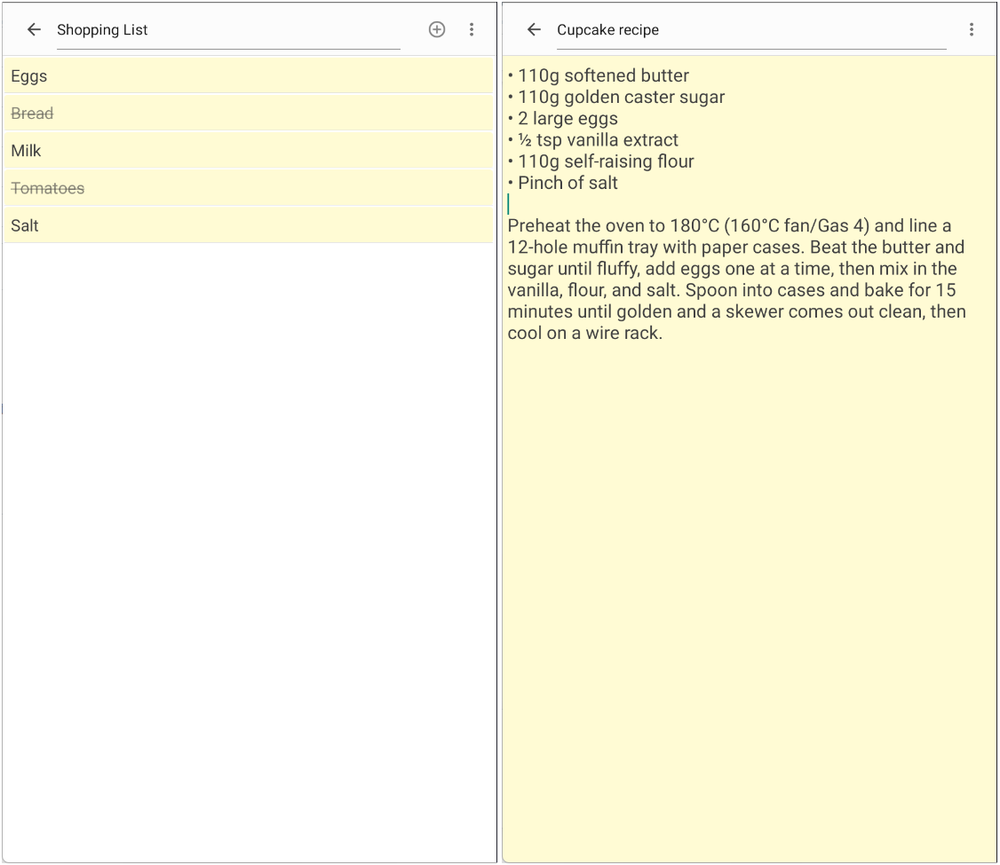

# Simple Android Notes App

No internet access, no ads, no in-app purchases. It just stores your notes on your phone.

## Features

- Plain text notes and checklists
- Adjustable text size
- Automatic note history with restore
- Trash for deleted notes
- Export notes as text files

## Requirements

Android 9 (API 28) or higher.

## Screenshots

## Building

Open the project in Android Studio and run the `app` configuration, or build from the command line:

    ./gradlew assembleRelease

## License

This project is licensed under the GNU General Public License v3.0. See the [LICENSE](LICENSE) file for details.
